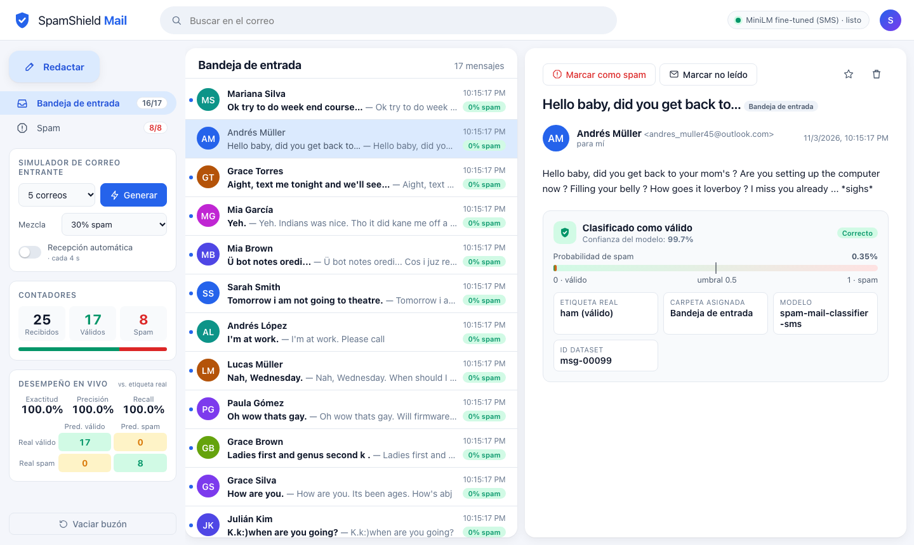

# SpamShield — Spam Detection with Transformers

End-to-end spam classification project built on the **SMS Spam Collection v.1** dataset and the Hugging Face model
[`Goodmotion/spam-mail-classifier`](https://huggingface.co/Goodmotion/spam-mail-classifier). It covers the complete
data-science workflow: exploratory data analysis, modelling, evaluation and deployment as a **Flask web application
that simulates a real mailbox**, with an *Inbox* and a *Spam* folder fed by the classifier.

> Course project for **Hackeando la Inteligencia Artificial**, Master's programme.



## Team

- Carlos Javier Cepeda
- David Hernando Salamanca
- Jose Milciades Ordonez

## Results at a glance

Evaluated on a held-out, stratified **test split of 774 messages** (de-duplicated, never seen during training):

| Model | Accuracy | Precision | Recall | F1 (spam) | ROC-AUC |
|-------|---------:|----------:|-------:|----------:|--------:|
| `Goodmotion/spam-mail-classifier` as published (zero-shot) | 0.423 | 0.148 | 0.771 | 0.249 | 0.656 |
| TF-IDF (word + char n-grams) + Logistic Regression baseline | 0.983 | **0.956** | 0.906 | 0.931 | 0.995 |
| **`Goodmotion/spam-mail-classifier` fine-tuned on SMS** (used by the app) | **0.988** | 0.949 | **0.958** | **0.953** | **0.999** |

**Key finding — domain shift.** The published model was trained on *e-mail subjects*. Applied directly to short,
informal SMS messages it flags most legitimate texts as spam (e.g. *"Are you free now? can i call now?"* → 99.9 % spam).
Fine-tuning the **same network** (Multilingual-MiniLM-L12-H384, ~118 M parameters) for 3 epochs on the SMS training
split (~1 minute on Apple Silicon) fixes this and gives the best F1 and recall. Full details are in the notebook.

## Dataset

*SMS Spam Collection v.1* (Almeida & Gómez Hidalgo, 2011): **5,574** English SMS messages labelled `ham`
(4,827 · 86.6 %) or `spam` (747 · 13.4 %), one `label<TAB>text` per line. The original files are kept in
`sms+spam+collection/` and copied to `data/raw/`. See `data/raw/readme` for sources and licence.

Preparation: 414 exact duplicates are removed (to avoid train/test leakage), leaving 5,160 messages, which are split
**70 / 15 / 15** (train / validation / test), stratified by class with a fixed seed.

## Project structure

```
spam_detection/
├── app/                        # Flask web application (SpamShield Mail)
│   ├── __init__.py             #   application factory
│   ├── __main__.py             #   `python -m app` entry point
│   ├── config.py
│   ├── routes.py               #   web page + JSON REST API
│   ├── services/
│   │   ├── classifier.py       #   singleton wrapper around the model
│   │   ├── generator.py        #   random dummy e-mail generator (reads emails.json)
│   │   └── mailbox.py          #   thread-safe mailbox (inbox / spam), persisted to JSON
│   ├── templates/index.html
│   └── static/{css,js}/
├── data/
│   ├── raw/                    # immutable original dataset
│   └── processed/              # train/val/test splits + emails.json (dummy mail pool)
├── models/                     # HF cache + fine-tuned checkpoint (git-ignored, regenerate with `make train`)
├── notebooks/
│   └── spam_detection.ipynb    # step-by-step data-science process (CRISP-DM), executed with outputs
├── reports/
│   ├── figures/                # EDA and evaluation charts exported by the notebook
│   ├── metrics.json            # test metrics for the three models
│   └── predictions.csv         # per-message test probabilities
├── scripts/
│   ├── train_model.py          # fine-tune the HF model
│   ├── evaluate_model.py       # compare models on the test split
│   └── build_email_db.py       # build data/processed/emails.json
├── src/spam_detection/         # reusable ML package
│   ├── config.py  data_loader.py  data_split.py  features.py
│   ├── model.py   train.py  baseline.py  evaluation.py  email_factory.py
├── tests/                      # pytest suite (data + API)
├── sms+spam+collection/        # dataset as originally provided
├── Makefile
├── requirements.txt
└── README.md
```

ML logic lives in `src/spam_detection` and is shared by the scripts, the notebook and the web app, so there is a
single source of truth for data loading, splitting and inference.

## Getting started

Requirements: **Python 3.12** (tested on macOS / Apple Silicon; CUDA and CPU also work).

```bash
# 1. Environment
python3.12 -m venv .venv
source .venv/bin/activate
pip install -r requirements.txt

# 2. Data, model and reports  (≈ 2–3 min; downloads the HF model on first run)
python scripts/train_model.py        # creates splits and fine-tunes -> models/spam-mail-classifier-sms
python scripts/evaluate_model.py     # -> reports/metrics.json, reports/predictions.csv
python scripts/build_email_db.py     # -> data/processed/emails.json

# 3. Web app
python -m app                        # http://127.0.0.1:8000
```

With `make`: `make all` (data → train → evaluate → notebook), `make run`, `make test`.

If no fine-tuned checkpoint is found, the app falls back to the original `Goodmotion/spam-mail-classifier`
from the Hub. You can force a model with `SPAM_MODEL_NAME=<hf-id-or-path>` and change the decision threshold with
`SPAM_THRESHOLD=0.5`.

## The web application — SpamShield Mail

A mail client mock-up that shows the classifier working the way it would in production:

- **Incoming mail simulator** – picks random messages from `data/processed/emails.json` (built from the *test*
  split, so the demo uses unseen data), gives each one a sender, address and subject, classifies it, and delivers it
  to **Inbox** (ham) or **Spam**. You can generate 1–25 at a time, choose the spam mix, or switch on
  *automatic reception* (one new e-mail every 4 s).
- **Two folders with counters** – unread/total badges, global counters (received / valid / spam) and a ratio bar.
- **Live performance panel** – accuracy, precision, recall and a confusion matrix comparing the classifier's
  decisions with the dataset's true labels as mail arrives.
- **E-mail detail view** – sender, body, spam probability bar with the decision threshold, model confidence,
  true label and whether the decision was correct, a false positive or a false negative.
- **User feedback** – *"Not spam"* / *"Mark as spam"* to move messages between folders, mark as unread, star, delete.
- **Compose** – write your own e-mail and watch a live prediction before it is delivered.
- Search, keyboard shortcuts (`c` compose, `g` generate, `Esc` close), light/dark theme, responsive layout.

### REST API

| Method | Endpoint | Description |
|--------|----------|-------------|
| `GET` | `/api/health` | Model in use, load status, threshold, pool size |
| `GET` | `/api/stats` | Folder counters and live evaluation metrics |
| `GET` | `/api/emails?folder=inbox\|spam\|all&q=` | List e-mails (with search) |
| `GET` | `/api/emails/<uid>` | E-mail detail (marks it as read) |
| `PATCH` | `/api/emails/<uid>` | Update `folder`, `read`, `starred` |
| `DELETE` | `/api/emails/<uid>` | Delete an e-mail |
| `POST` | `/api/generate` | `{"count": 5, "spam_ratio": 0.3}` – generate, classify and deliver |
| `POST` | `/api/compose` | `{"sender_name", "sender_email", "subject", "body"}` |
| `POST` | `/api/classify` | `{"subject", "body"}` – classify without delivering |
| `POST` | `/api/reset` | Empty the mailbox |

## Notebook

`notebooks/spam_detection.ipynb` documents the whole process, with outputs included:

1. **Business understanding** – cost of false positives vs false negatives, metric choice.
2. **Data understanding / EDA** – data quality and duplicates, class imbalance, message length distributions,
   engineered features (uppercase, digits, punctuation, URLs, phone numbers, currency), Mann-Whitney U tests,
   binary-flag prevalence, **correlation matrix** and point-biserial correlation with the target, top words and
   bigrams, word clouds, χ² discriminative terms and a 2-D LSA projection.
3. **Data preparation** – de-duplication and stratified split.
4. **Modelling** – zero-shot HF model and domain-shift diagnosis, TF-IDF baseline, fine-tuning.
5. **Evaluation** – metric table, confusion matrices, ROC and precision-recall curves, threshold analysis on
   validation, error analysis.
6. **Deployment** – how the web app uses the model.

## Tests

```bash
python -m pytest -q
```

API tests use a lightweight fake classifier, so they run in about a second without loading the transformer.

## References

- Almeida, T.A., Gómez Hidalgo, J.M., Yamakami, A. *Contributions to the Study of SMS Spam Filtering: New Collection and Results.* ACM DocEng 2011.
- Goodmotion. *spam-mail-classifier.* Hugging Face, https://huggingface.co/Goodmotion/spam-mail-classifier (Apache-2.0).
- Wang, W. et al. *MiniLM: Deep Self-Attention Distillation for Task-Agnostic Compression of Pre-Trained Transformers.* NeurIPS 2020.
